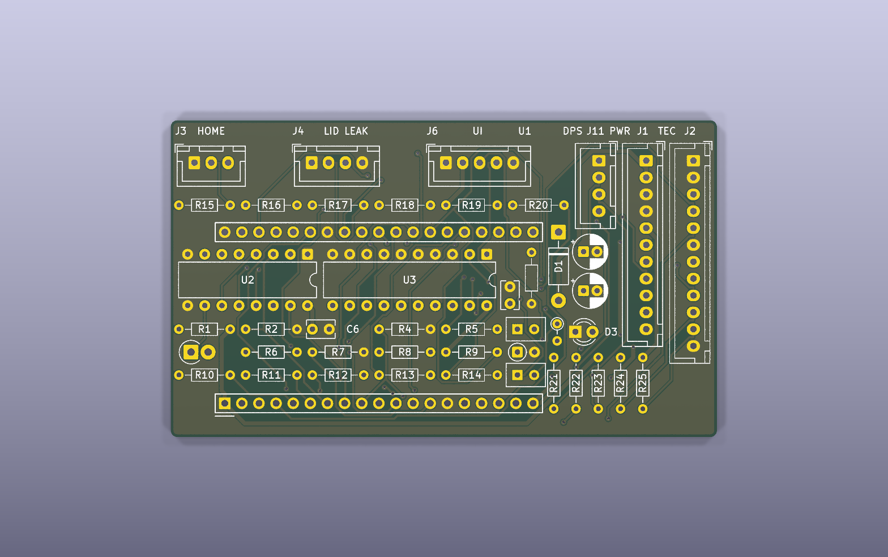
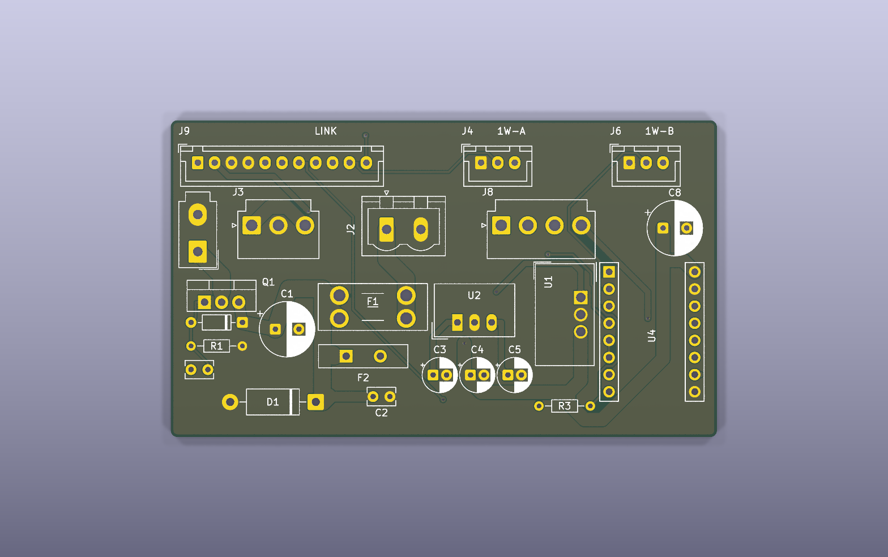
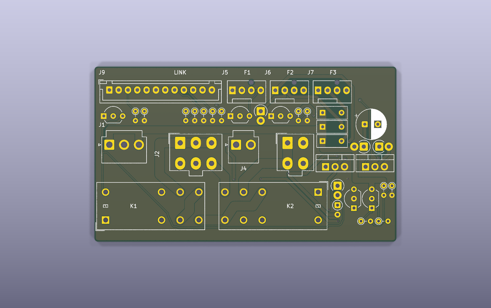

# D34 hand-soldered controller (three vertical cards)

**Status: generated, ERC/DRC-checked design files. Not fabricated, not
soldered, not powered, no firmware.**

- Rationale, power budget, TVS analysis and open questions: [kb/d34-controller.md](../../kb/d34-controller.md).
- Decision: [D34](../../kb/decisions.md).

Bare 2-layer boards (1.6 mm FR-4, 1 oz), fabrication only. Every part is
through-hole or a plug-in module. Two upload packages per card:
`<card>-pcbtrain.zip` (PCB Train / Newbury Electronics, UK; recommended UK
fab) and `<card>-jlcpcb-gerbers.zip` (JLCPCB, much cheaper). Components:
RS Components UK except one Farnell line and two module retailers; the
sourced BOM, totals and fab comparison are in
[kb/d34-sourcing.md](../../kb/d34-sourcing.md).
3D envelopes for CAD: [`parts3d.json`](parts3d.json) (schema below).

All three cards are **81 × 47 mm**, sized to the CAD-checked bay (44 radial ×
85 tangential × 51 mm high). Each stands in a floor slot with its plane
tangential and components facing the axis. The top long edge takes a
printed clip. 3 mm long-edge bands are free of pads and courtyards.

| Card | Bay | Contents |
|---|---|---|
| [`d34-ctrl`](d34-ctrl/) | 45° | Socketed ESP32-DevKitC-32E, lid/leak/home/UI/DPS-UART headers, TEC watchdog (74HC123) and defrost latch (74HC573). Only 5 V and 3.3 V. |
| [`d34-pwr`](d34-pwr/) | 225° | 24 V brick entry, reverse FET, TVS, 7.5 A DPS fuse, 1.1 A PTC aux, TRACO 12 V 2 A / 5 V 1 A bucks, DPS5005 feed, StepStick (VMOT 12 V) + motor, one 1-Wire header per bus. |
| [`d34-tec`](d34-tec/) | 315° | K1 cut-off and K2 reversal relays (2N3904 low sides, K2 hold-up), thermostat loop, DPS output in, TEC out, three fan headers with IRLZ44N low sides and a 0.5 A polyfuse each. |





## Inter-card leads (keyed, same pin order both ends; checked by `test_d34.py`)

| Lead | Type | Pins |
|---|---|---|
| ctrl J1 ↔ pwr J9 | JST XH-11 | 1-2 +5 V, 3-4 GND, 5 +3V3, 6 STEP, 7 DIR, 8 EN, 9 TMC UART, 10 1-Wire A, 11 1-Wire B |
| ctrl J2 ↔ tec J9 | JST XH-12 | 1-2 GND, 3 K1_ON, 4 K2_ON, 5 THERMO_OK, 6 GND, 7-9 FAN1-3 PWM, 10-11 TACH1-2, 12 GND |
| pwr J3 → tec J1 | JST VH-3 | 1 +12 V, 2 GND, 3 +12 V |

## Card connectors

Pin 1 is the square pad or the silkscreen triangle.

| Card | Ref | Type | Pins |
|---|---|---|---|
| pwr | J1 | Mini-Fit Jr 2 | 1 +24 V in, 2 GND (brick) |
| pwr | J2 | Phoenix MSTB 2 | DPS5005 input: 1 IN+ (7.5 A fused), 2 IN− |
| pwr | J8 | JST VH-4 | Motor 2B 2A 1A 1B (17HS08-1004S: confirm coil pairs with a meter) |
| pwr | J4 / J6 | XH-3 | 1-Wire bus A (chamber air + food probes) / bus B (hot sink + room): GND, DQ, 3V3. The harness Y-splices each bus to its probes; more probes can join either bus. |
| tec | J2 | Mini-Fit Jr 6 | DPS5005 output: 1-3 OUT+, 4-6 OUT− (OUT− is **not** ground). The lead populates only pins 1 and 4 (one 18 AWG wire per pole, ≤ 5 A on a 9 A contact); the 6-way housing keeps it unpluggable into the 4-way TEC header. |
| tec | J3 | Mini-Fit Jr 4 | TEC 2S2P: 1 A, 2 B, 3 A, 4 B (one string per pair) |
| tec | J4 | JST VH-2 | Thermostat loop: 1 +12 V out, 2 return to K1 coil. Four RS PRO T24A060ASF2-15 NC (open 60 °C) in series. |
| tec | J5 | 4-pin fan | FAN1 (NF-A12x25): GND, +12 V via 0.5 A PTC, TACH, PWM (NPN open collector, **inverted**) |
| tec | J6 | 4-pin fan | FAN2 (blower): switched low side (IRLZ44N), +12 V via 0.5 A PTC, TACH, NC |
| tec | J7 | 4-pin fan | FAN3 spare: switched low side (IRLZ44N), +12 V via 0.5 A PTC, NC, NC (fan or external 12 V relay ≤ 0.4 A) |
| ctrl | J3 | XH-3 | Home sensor (DRV5023 hall, 3.3 V, open drain into the 10 k pull-up): GND, SIG, 3V3 |
| ctrl | J4 | XH-4 | SENSE: 1 GND, 2 LID (reed to GND, 10 k pull-up), 3 LEAK (basin-full pins, 47 k pull-up, 10 k series to ADC), 4 GND. Two cables, one housing. |
| ctrl | J6 | XH-5 | Panel: GND, 3V3, LED (330 Ω fitted), BUTTON (to GND), GND |
| ctrl | J11 | XH-4 | DPS5005 UART 3.3 V: GND, DPS-TX, DPS-RX, NC. DPS end: the 4-pin 1.25 mm (JST-GH type) comms socket; make the lead from the cable supplied with the DPS comms kit, meter GND and the idle-high TX first (see kb/d34-sourcing.md). |

**StepStick (pwr U4).** BIGTREETECH TMC2209 V1.3 is the intended driver
(pinout from BTT's V1.3 schematic, `datasheets/btt_tmc2209_v13_sch.pdf`).
- **VMOT is +12 V** from the TSR 2-24120N, not the 24 V brick, so the TVS
  clamp (30–33 V) can never reach the TMC2209 (32 V abs max).
- Pin 4 (PDN_UART) is wired to the ESP32 single-wire UART: TX via 1 k (ctrl
  R6), RX direct. BTT V1.3 has no series resistor on the module, so R6 is needed.
- Pins 5 and 6 are linked to each other only. BTT V1.3: pin 5 is not connected
  on the module, pin 6 is CLK with a 20 k pull-down (internal clock). A4988:
  RESET tied to SLEEP, which the Pololu carrier pulls up (Pololu's own advice).
- MS1/MS2 are open: the TMC2209's internal pull-downs give UART address 0.
- A Pololu A4988 also fits, but only at full step. Firmware must then hold
  IO17 low and keep IO16 as an input, so that MS3 = 0.

## ESP32 GPIO map

| GPIO | Use | GPIO | Use |
|---|---|---|---|
| IO0 | Button (also BOOT) | IO19 | EN (active low) |
| IO2 | Status LED (panel + on-board) | IO21 / IO22 | DPS RX / TX |
| IO4 / IO13 | 1-Wire A / B | IO23 | HOME |
| IO5 | FAN3 on/off | IO25 | DEFROST_REQ |
| IO12 | FAN1 PWM (10 k strap pull-down) | IO26 | DEFROST_FB |
| IO14 | FAN2 on/off (switched DC) | IO27 | LID |
| IO15 | DIR | IO32 | TEC_EN |
| IO16 / IO17 | TMC UART RX / TX | IO33 | WDT_KICK |
| IO18 | STEP | IO34 / IO35 | TACH1 / TACH2 |
| IO36 | THERMO_OK | IO39 | LEAK (ADC) |

## TEC firmware contract (hardware-enforced parts and firmware rules)

Revised 2026-10-26 after the simulation round ([kb/d34-simulation.md](../../kb/d34-simulation.md)).

1. **K1 closes only while all of these hold:**
   - TEC_EN (IO32) is high;
   - IO33 (WDT_KICK) shows rising edges at **≥ 10 Hz** (74HC123 timeout 470 k × 1 µF ≈ 0.47 s nominal,
     **0.32–0.65 s** over K = 0.69–1.36 at 3.3 V, C ±10 %, R ±1 %);
   - +12 V is present and every thermostat is closed (the K1 coil is fed through them).

   Reset, a crash, a stuck pin, an unplugged lead or a lost 12 V rail opens K1.
2. **Firmware rules the hardware cannot enforce:**
   - toggle WDT_KICK from the control loop in software, **never from a hardware PWM/LEDC/timer**
     (a hung CPU with a running PWM would keep K1 closed);
   - **never pulse TEC_EN as a keep-alive**: a TEC_EN rising edge while WDT_KICK is high retriggers the
     74HC123 through its CLR input;
   - read the blower tach (TACH2) only while FAN2 is fully on: FAN2/FAN3 are now **switched DC**
     (no 25 kHz PWM), and the tach is referenced to the switched ground. FAN1 keeps 25 kHz PWM (inverted).
3. **K2 (defrost polarity)** follows DEFROST_REQ only while the latch is transparent: K1 commanded off for
   longer than the 74HC123 half-2 delay (0.32–0.65 s). LE edges are now CMOS-fast. K2 also has a
   hold-up (C1 220 µF): after its drive drops it stays energised for up to ~0.25 s, so on any supply loss
   K1 (fast diode + 15 V zener release) always opens first. Defrost entry and exit:
   - DPS output off (Modbus);
   - TEC_EN low;
   - wait **≥ 0.8 s** (latch delay max 0.65 s);
   - set or clear DEFROST_REQ;
   - wait **≥ 400 ms** (K2 transfer; on exit K2 is held up to ~0.25 s by C1), then check DEFROST_FB;
   - re-arm (TEC_EN high + kicks), wait ≥ 50 ms for K1 to close;
   - only then DPS output on. **Keep the DPS output off until K1 is re-armed.**
4. **After any reset or brown-out** run the full contract from boot before re-arming K1: the 74HC573
   contents (K2 command) are undefined at power-up. Keep TEC_EN low and the DPS output off, drive
   DEFROST_REQ to the wanted state, wait ≥ 0.8 s (latch delay ≤ 0.65 s, so the latch has loaded it), wait
   ≥ 0.4 s, check DEFROST_FB, then re-arm and only then turn the DPS output on. Timings as in
   `sim/firmware_contract.json` (owned by the simulation agent).
5. **12 V undervoltage cut-off (hardware, tec card):** the thermostat loop that feeds K1's coil is switched
   by Q6 (BC327) under a TL431 comparator: K1 drops below ~9.4 V on +12 V and can re-close only above
   ~10.3 V. While it is tripped THERMO_OK reads low, the same as an open thermostat.
6. **THERMO_OK** (IO36) reads about 3.0 V (2.85–3.15 V) when the thermostat loop is closed; reading it with
   the ADC (threshold ~1.4 V) gives more margin than a digital read. IO36 is now fed through 47 k with a
   BAT42 clamp to GND (a thermostat opening drags the loop to about −15 V for a few ms).
7. **Reversed-brick ring snubber:** 2.2 Ω + 1 µF in series across the inlet socket's +24 V and 0 V pins
   (off-board, at the Kycon socket), keeping the reversed-plug ring at J1 within Q1's 55 V rating.

## Files (per card directory)

| File | Purpose |
|---|---|
| `<card>.kicad_pro/.kicad_sch/.kicad_pcb` | KiCad 9 project; local libs `d34.kicad_sym`, `../d34.pretty` |
| `<card>.kicad_dru` | Copy of [`../dfm/jlcpcb-2layer-recommended.kicad_dru`](../dfm/README.md) |
| `<card>-pcbtrain.zip`, `pcbtrain/` | Upload to PCB Train: RS-274X without X2, Excellon PTH/NPTH, README.txt |
| `<card>-jlcpcb-gerbers.zip`, `gerbers/` | Upload to JLCPCB (Gerber X2 + Excellon PTH/NPTH) |
| `<card>-bom.csv` | Card BOM with supplier, stock number, pack, datasheet and verification state; off-board mating parts |
| `erc.*`, `drc.*`, `validation.json` | Check results for exactly these files |
| `envelope.json` | Courtyards and body/mated heights for CAD |
| `views/` | `render-top/bottom.png`, `top/bottom/assembly.svg`, `schematic.pdf`, `board-only.step` |

Shared sources:
- `design.py`: connectivity, placement and hand-placed high-current copper.
- `catalog.py`: parts, footprints, heights, 3D envelopes, RS stock numbers, datasheet references.
- `sourcing.py` → `sourcing/bom-sourced.{csv,json,md}`: all three cards plus
  off-board parts, packs, price breaks and totals from the dated public
  snapshot `sourcing/findchips-2026-10-26.json` and `sourcing/manual.json`.
- `parts3d.py` → `parts3d.json`: per-part 3D boxes/cylinders for CAD.
- `datasheets/` + `datasheets_manifest.py` → `datasheets/MANIFEST.json` (SHA-256, source URL). Fetch the
  manufacturer PDFs with `scripts/fetch_references.py`.
- `pcbtrain-2layer.kicad_dru`: PCB Train's published minimums; `export.py` runs it as a second DRC.
- Scripts: `build.py`, `route.py`, `finish.py`, `export.py`, `test_d34.py`, `run.sh`, `chk.sh`.

## Regenerate

Uses the `cat-feeder-kicad:local` image: KiCad 9.0.2 and Java 21, built from
[`../pcb/Dockerfile`](../pcb/Dockerfile). Download Freerouting 2.1.0 from the
official release (SHA256 `2c07d58f…5def`, which `route.py` checks); it is not
stored in the repo.

```sh
cd electronics/d34
export FREEROUTING_JAR=/path/to/freerouting-2.1.0.jar
for c in ctrl pwr tec; do
  ./run.sh build.py $c      # schematic, placed PCB with locked TEC/24 V copper, rules, DSN
  ./run.sh route.py $c 40   # Freerouting, gap finisher, stub cleanup, GND pours (retries)
  ./run.sh export.py $c     # ERC/DRC x2 (JLCPCB + PCB Train rules), Gerbers, views, BOM, envelope
done
./run.sh parts3d.py       # parts3d.json for CAD
./run.sh test_d34.py
python3 sourcing.py; python3 datasheets_manifest.py
./chk.sh <card>             # quick placement-only DRC while editing design.py
```

Freerouting is not deterministic. KiCad DRC on the saved board, not the
router's own report, decides whether a card is complete. The back-silkscreen
version string is a SHA-256 of the generator sources (D30).

## `parts3d.json` (schema `d34-parts3d/1`, for CAD)

Regenerate with `./run.sh parts3d.py` after any board change. Conventions are embedded in the file.
- Per card: origin = top-left corner seen from the component side; +x along the long edge, **+y down**
  (y = 0 clip edge, y = 47 slot edge), +z out of the component side; z = 0 component-side copper,
  z = −1.6 solder side. (x, y-down, z) is left-handed: use v = 47 − y for a right-handed frame. Units mm.
- `cards.<card>`: `bay`, `kicad_pcb`, `board` (outline, thickness, corner radius, edge bands),
  `envelope` (component-side max z, solder-side min z), `parts[]`.
- `parts[]`: `ref, kind, value, mfr, mpn, footprint, origin [x,y], rotation_deg` (KiCad), `ref_doc`,
  shape lists `bodies` (fitted part), `solder` (trimmed leads, z ≤ −1.6), `mated` (plug or plug-in
  module), `cable` (wire bundle + bend allowance), `service` (finger/tool/USB space, not occupied in
  service), `lead_exit {direction, face_centre, [alternative_direction], note}`, `max_z`, `notes`.
- Shapes: `{"type":"box","min":[x,y,z],"max":[x,y,z]}` or
  `{"type":"cylinder","axis":"z","centre":[x,y],"r":r,"z":[z0,z1]}`, each with `what` and
  `src` = `datasheet` | `footprint` | `estimate`.

## What was checked (automated, on these files)

- **ERC and DRC** at all severities, including schematic parity: zero
  violations and zero unconnected items for each card. Rules: JLCPCB
  recommended DRU, net classes, and a 0.7 mm edge keep-out for router
  copper. A second DRC against PCB Train's published minimums
  (`pcbtrain-2layer.kicad_dru`) also passes. 164 tests pass (`test-results.json`), source hash `c24e0a5435e3`.
- PCB Train Gerbers are plain RS-274X: KiCad writes the X2 attributes as `G04` comments only.
- **`test_d34.py` footprint checks:**
  - DevKitC rows 25.40 mm apart, pitch 2.54 mm.
  - StepStick pads identical to KiCad's Pololu footprint (rows 12.70 mm apart).
  - G2RL-2 hole grid.
  - Pitches: XH 2.50, VH 3.96, fan 2.54, MSTB 5.08, Mini-Fit 4.20 × 5.50; DIP rows 7.62 mm.
- **`test_d34.py` circuit checks:**
  - Every 24 V and TEC power path, and that TEC nets are isolated from GND.
  - K1 is fed through the thermostat loop only.
  - Watchdog and latch wiring; boot-safe pull-downs.
  - No rail above 5 V on the controller.
- **`test_d34.py` connector and lead checks:**
  - Keyed connector families.
  - Any two connectors of the same family and pin count carry compatible voltage roles.
  - Each lead has the same type and pin order at both ends.
- **`test_d34.py` geometry checks:**
  - 3 mm bands free.
  - Silkscreen text ≥ 1.0/0.15 mm.
  - Parts under the DevKit ≤ 8 mm tall.
  - **Each card fits the bay:** ≤ 81 × 47 mm; component-side depth ≤ 36 mm including mated plug and bend; solder side ≤ 3 mm; everything (including the DevKit antenna) inside the 85 mm envelope.
  - TEC/24 V copper width.

**Not checked:** fabrication, solderability, current/thermal behaviour, relay
switching, firmware, EMC, or physical fit. Part dimensions are from datasheets
(`datasheets/MANIFEST.json`), except the estimates flagged in `parts3d.json`.
