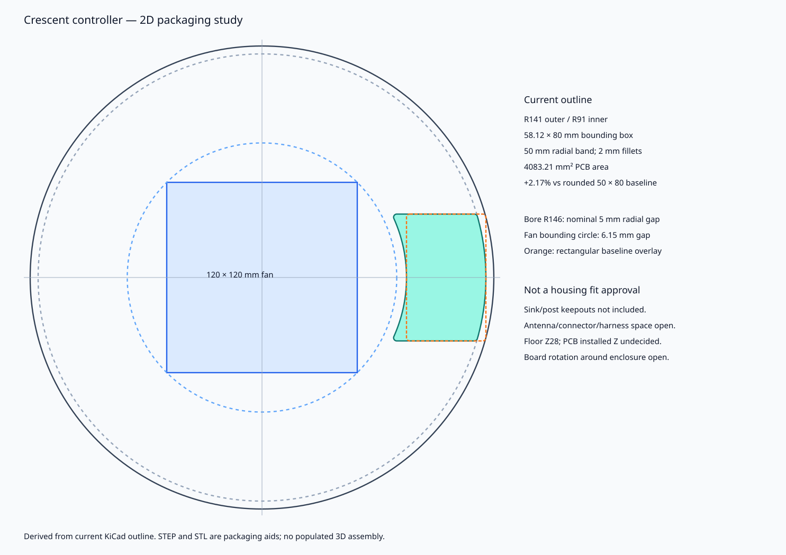

# Shallow crescent packaging study

The owner's latest preference is a compact wall-following crescent if packaging warrants it. The current routed PCB therefore uses **two concentric curved edges**, not a large ring. Only J1 moved 2.5 mm inward in the earlier rectangular-to-crescent conversion. The subsequent review corrections preserve **all 52 original crescent placements and the exact outline**; new 0603 resistors are R20 **(79,113,0°)** and R21 **(91,109,90°)** in KiCad coordinates. All 54 parts remain top-side populated. See [fix provenance](REVIEW-FIXES.md); supplier-project creation remains on D25 HOLD pending independent recheck.

## Dimensions and comparison

| Quantity | Current crescent | Compact baseline |
|---|---:|---:|
| Bounding box | **58.12 × 80.00 mm** | 50.00 × 80.00 mm |
| Board area | **4083.21 mm²** | 3996.57 mm² |
| Area change | **+2.17%** | Reference |
| Radial band at midline | 50 mm: R91→R141 | 50 mm |
| Outer/inner radii | 141 / 91 mm | Flat long edges |
| Corner fillets | 2 mm | 2 mm |
| Mounting holes | None | None |

Area is calculated from the **current KiCad Edge.Cuts polygon**, not estimated from the bounding rectangle. The broader bounding box adds about 16% to a rectangular panel cell, while actual PCB area rises only 2.17%. Supplier panelisation/price may follow the bounding cell rather than material area. This trade-off is small enough for a packaging study; a full circular ring would waste substantially more space/material.

At enclosure-centred placement, R141 leaves a nominal **5 mm** radial gap inside the supplied **R146 bore**. R91 is **6.15 mm** beyond the circumscribed radius of a centred **120 mm square fan**, providing an orientation-independent 2D fan-envelope bound. Those numbers exclude tolerance, wires, guards and retaining walls.

The rectangular baseline overlaid at the same midline has outer corners beyond the R141 keep-clear circle; it can be moved inward approximately **5.79 mm** (conservative unrounded-corner calculation) to maintain that same outer allowance. That reduces its conservative inner-radius gap to the fan's bounding circle to approximately 0.35 mm. A rectangle can still fit by choosing an appropriate orientation/placement; the comparison does not prove the crescent is necessary. The crescent preserves the radial band while following the wall with little extra PCB area.

## Explicit unresolved fit assumptions

- **This does not fit the existing CAD pockets/posts as currently modelled.** Primary mechanical review must select rotation/location and verify all sink/post/retention/harness keepouts.
- TEC sites at radius 105 mm and their sink/post volumes can overlap this PCB's planar projection. They are **not** included in the bore/fan-only diagram. Height separation or relocation may be needed; a wall-conforming outline alone does not resolve these collisions.
- Supplied floor is **Z28 mm**. No installed PCB Z is assigned: allow clearance beneath through-hole tails, an insulating support and connector access. Board nominal thickness is 1.6 mm; sockets, capacitor, carrier/heatsink and harness bends define the eventual assembly height.
- Preserve the ESP32 antenna's no-copper region and external metal/component clearance. PCB edge conformity does not establish RF performance next to the enclosure's other hardware.
- Single-side SMT+THT, two copper layers and ordinary routed arcs target **JLC Economic PCBA**. Published service minimum is **two assembled boards**. A temporary rectangular panel/handling rails and tab positions may be needed for the crescent; supplier-specific panelisation/part eligibility remains a quotation question. No panel/tooling geometry is imposed here.

## Mechanical handoff

- [Current board-only STEP](views/board-only.step): exact curved board with holes, no component models; origin matches Gerber/CPL lower-left bounding corner. To centre it on the enclosure in XY, translate **(+82.88227, −40) mm** before choosing rotation. STEP Z is local board geometry, not enclosure installation height.
- [Board-envelope STL](views/board-envelope.stl): current KiCad outline extruded 1.6 mm, **holes and components omitted**. Already enclosure-centred XY (`x = KiCad_x + 41`, `y = 90 − KiCad_y`), bottom at Z0. Add chosen installation Z and rotation. This is a packaging envelope, not a printable controller.
- [Outline vertices/assumptions](outline-study.json), [mesh validation](mesh-check.json), [component positions](design-bom.csv), [assembly view](views/assembly.svg). STL was reloaded and checked for watertightness, winding, positive volume and actual bounds after export.
- `outline.py` is the small parameterised outline source; `packaging.py` derives the comparison/mesh from the actual exported KiCad polygon. Primary owns any enclosure changes.

## Catalogue/API boundary

This correction uses the existing [public catalogue evidence](stock-evidence.json). The later D25 supplier-project workflow supersedes the earlier proposed API application, but supplier-project creation remains blocked pending focused independent recheck. No credential, authenticated request, upload, quote or order operation was used for these corrections.
