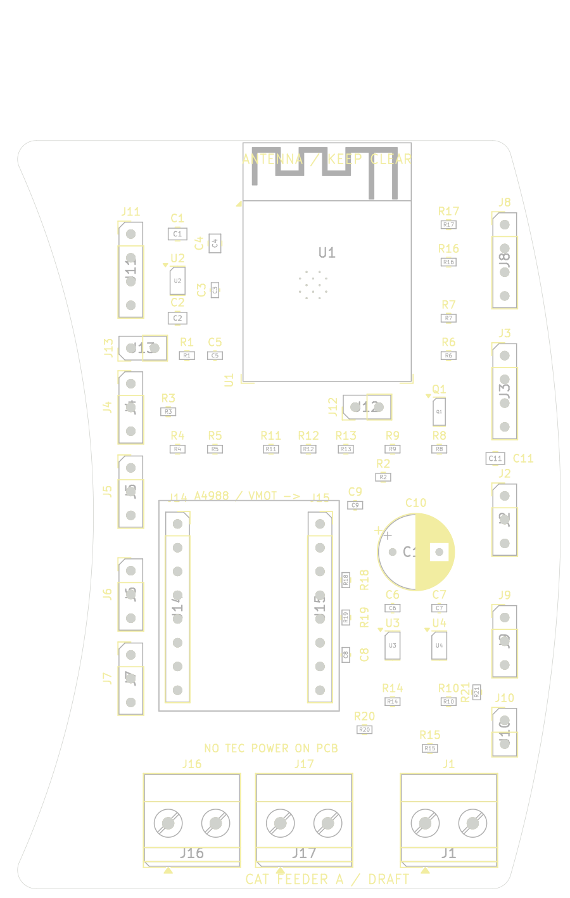

# Cat-feeder controller — revision A draft

Editable **KiCad 9** schematic and fully connected, two-layer **shallow crescent PCB, 58.12 × 80 mm bounding box**. Actual area is only **2.17% above the 50 × 80 mm rectangular baseline**. This is a checked design draft, not a fabricated/tested controller. Start with [packaging assumptions/comparison](PACKAGING.md), [design rationale](../../kb/pcb-design.md) and [check results](CHECKS.md).

**D25 HOLD: review corrections are ready for focused independent recheck; supplier-project creation remains prohibited.** [Precise B1/B2/rule-fix record](REVIEW-FIXES.md). Current revision adds R20/R21; all original placements and the outline are preserved.



## Files

| File | Purpose |
|---|---|
| `feeder.kicad_pro`, `feeder.kicad_sch`, `feeder.kicad_pcb` | Open the project in KiCad 9; current editable design |
| `feeder.pretty/`, `fp-lib-table`, `sym-lib-table` | Local footprint copies; schematic embeds its symbols and references standard KiCad 9 symbol libraries |
| `views/schematic.pdf`, `views/feeder.svg` | Current schematic; net-labelled pin stubs carry the electrical connections |
| `views/top.svg`, `views/bottom.svg`, `views/assembly.svg` | Current copper/component views; bottom view is **not mirrored**, seen through the board from above |
| `views/board-only.step`, `views/board-envelope.stl`, `outline-study.json` | Curved-outline mechanical handoff; coordinate systems and omitted geometry in [PACKAGING.md](PACKAGING.md) |
| `design-bom.csv`, `connectivity.json`, `schematic-netlist.xml` | Full design BOM and connectivity |
| `assembly-bom.csv`, `assembly-cpl.csv` | **36 SMT placements only**, grouped supplier BOM and placement input |
| `assembly-bom-all.csv`, `assembly-cpl-all.csv` | **54-part mixed SMT+THT draft** with corrected body centroids; supplier zero angles pending |
| `quotation-bom-all.csv` | All **54 parts**, including 18 THT parts for later mixed-process quotation scope |
| `assembly.py`, `assembly-reconciliation.json` | Exact-code body offsets, all 54 placements/pads and orientation landmarks |
| `REVIEW-FIXES.md`, `review-fix-validation.json` | B1/B2 provenance, placement preservation and focused-recheck handoff |
| `manufacturing/`, `manufacturing-draft.zip` | Current nine Gerbers, job file and Excellon drill file |
| `stock-evidence.json` | Timestamped public JLC inventory fields, URLs and response hashes |
| `erc.rpt`, `drc.rpt`, `validation.json`, `checksums.json` | Checks against these files, not an earlier routing revision |
| `generate.py`, `outline.py`, `route.py`, `finish_route.py`, `export.py` | Source generator, curved outline, route import/finishing and fail-on-violation export |
| `feeder-unrouted.kicad_pcb`, `feeder.dsn`, `feeder.ses` | Placement and offline routing intermediate files; open **feeder.kicad_pcb** for the finished draft |

Gerber, drill and CPL share the lower-left board-bounding-box origin: X right, Y up, at KiCad **(41.88227, 130) mm**. The CAD board occupies approximately X41.882–100/Y50–130 mm. CPL now uses **component-body centroids**, with explicit offsets for all 18 THT parts rotated before origin conversion. Centred SMT origins are preserved. Angles remain native KiCad; supplier library zero-angle/pad alignment remains pending. See [reconciliation](REVIEW-FIXES.md#b2-true-body-centroid-export).

## Assembly scope

- SMT: ESP32-WROOM-32E-N4, AP2112K-3.3 LDO, two UART gates, fan transistor and passives. All selected SMT codes had positive direct JLC stock on 2026-10-24.
- THT: 3 Phoenix screw terminals, 2 A4988 sockets, 12 other headers and 1 motor bulk capacitor. All have exact stocked catalogue candidates; JLC marks them `manualWeld`. For fitted terminals/headers use the **`-all` BOM/CPL pair** and quotation scope, rather than the SMT-only pair. See [sourcing](SOURCING.md) and [assembly-service research](../../kb/pcb-assembly.md).
- Separate integration: A4988 carrier, external 5 V/12 V converters, protected 20/24 V motor source, DPS5005, TEC power switching/interlock, sensors, fan and all harnesses. The A4988 carrier is **not** in the assembler BOM.
- Board specification for quotation: 2 layers, nominal 1.6 mm FR-4, nominal 1 oz copper, solder mask both sides, top silkscreen, no mechanical mounting holes. No current rating is inferred from this specification.
- Target service: Economic PCBA, single-side SMT+THT, **minimum two assembled boards**. Curved-board handling rails/panelisation and exact part eligibility remain supplier questions. Public stock evidence remains the source; D25 blocks project preparation until focused recheck passes.
- Twelve 0.2 mm plated holes in the ESP32 thermal land need assembler review for drilling, paste and solder wicking. Routing vias are 0.6/0.3 mm. Confirm programming/test provision and module handling with the assembler at quotation stage.

## Connector pinout

Pin numbers are the PCB pad numbers; pin 1 has the square pad. Header pin 1 is normally uppermost in the top view; J12/J13 run left-to-right. Verify harness numbering rather than relying on wire colour. All grounds on this board are common.

| Ref | Pins in numerical order | Notes |
|---|---|---|
| J1 | 1 VMOT, 2 GND | Protected **20–24 V** motor input; not TEC power |
| J2 | 1 GND, 2 +5 V, 3 +12 V | External regulated rails; never put motor voltage here |
| J3 | 1 GND, 2 +12 V, 3 TACH, 4 PWM | Generic 2.54 mm header, **not a keyed PC-fan receptacle**; adapter harness required |
| J4/J5 | 1 GND, 2 DQ, 3 +3.3 V | Powered DS18B20 probes; shared 1-Wire bus, single 4.7 kΩ pull-up |
| J6 | 1 GND, 2 INDEX, 3 +3.3 V | 3.3 V-compatible optical module/open-collector input |
| J7 | 1 GND, 2 HOME, 3 +3.3 V | Independent home sensor; 10 kΩ pull-up |
| J8 | 1 GND, 2 +3.3 V, 3 SDA, 4 SCL | Optional I²C; 4.7 kΩ pull-ups fitted |
| J9 | 1 GND, 2 **DPS RX**, 3 **DPS TX** | Names are from the DPS's perspective; no DPS VCC connection |
| J10 | 1 GND, 2 TEC_EN | Default-low **3.3 V logic only**; requires separately designed compatible enable/interlock stage |
| J11 | 1 GND, 2 ESP TX0, 3 ESP RX0, 4 +3.3 V reference | External 3.3 V UART adapter; cross adapter TX/RX; pin 4 is a reference, not a 5 V input |
| J12 | 1 BOOT/GPIO0, 2 GND | Short while resetting to enter ROM download mode |
| J13 | 1 EN, 2 GND | Momentarily short to reset |
| J14 | EN/GND, MS1/+3V3, MS2/+3V3, MS3/+3V3, RESET/MOTOR_RUN, SLEEP/MOTOR_RUN, STEP, DIR | A4988 control row, pin 1→8 |
| J15 | VMOT, GND, 2B, 2A, 1A, 1B, VDD/+3V3, GND | A4988 power row, pin 1→8; 15.24 mm from J14 |
| J16 | 1 M1A, 2 M1B | Motor winding 1 |
| J17 | 1 M2A, 2 M2B | Motor winding 2 |

J14 and J15 are for the standard **Pololu-layout A4988** carrier viewed from its component side, VMOT at the upper-right. Confirm a purchased clone's pinout before insertion. DRV8825 or other drop-ins have not been qualified. Set the carrier's current limit for the actual motor; disconnect power before changing motor wiring.

## Firmware interface and reset behaviour

No firmware is supplied. GPIO numbers below are ESP32 GPIOs, not WROOM pad numbers.

| GPIO | Function | Behaviour/requirement |
|---|---|---|
| 16 / 17 | DPS RX / TX | UART through separate SN74LVC1G125 gates |
| 13 | UART_OEn | 10 kΩ pull-up disables both gates during reset; drive low only after qualification/startup |
| 18 / 19 | STEP / DIR | 100 kΩ pull-downs; A4988 fixed 1/16 microstepping |
| 23 | MOTOR_RUN | 10 kΩ pull-down; RESET and SLEEP low at reset; drive high, then observe carrier wake-up delay before stepping |
| 25 | TEC_EN | 10 kΩ pull-down; active high only for an external stage designed for this input |
| 26 | FAN_PWM_GPIO | MMBT3904 open-collector output, **inverting**; use nominal 25 kHz and account for inversion |
| 27 | 1-Wire DQ | Powered DS18B20 bus |
| 32 / 33 | INDEX / HOME | 10 kΩ pull-ups; debounce/filter in firmware |
| 34 | FAN_TACH | Input-only, external 10 kΩ 3.3 V pull-up and 1 kΩ series resistor; open-collector tach expected |
| 35 | BUS_SENSE | ADC1, 100 kΩ/10 kΩ divider plus 100 nF: nominal bus/11 (24 V→2.18 V); calibrate attenuation/gain |
| 21 / 22 | SDA / SCL | Optional 3.3 V I²C |
| 0 / EN | BOOT / RESET | 10 kΩ pull-ups; EN has 1 µF delay capacitor |
| 1 / 3 | UART0 TX / RX | Programming/diagnostics on J11 |

With the MCU reset, Q1 is off so the fan's PWM pin is released high; a conforming four-wire fan should run at full speed. This depends on the chosen fan's internal pull-up. Fan motor power is always connected to +12 V; this circuit cannot switch it off independently.

The DPS RX buffer input tolerates up to 5.5 V; its output to the ESP32 is 3.3 V. Board TX is buffered 3.3 V through 1 kΩ, **not a 5 V translator or RS-232 interface**. Check the exact DPS hardware's UART voltage/threshold, ground relationship, protocol and power-order behaviour. OE disables board drivers; it is not galvanic isolation. **J10 is not a verified DPS5005 enable-pin connection**, and default-low logic does not by itself disconnect TEC power. Implement and test an external fail-off power stage and overtemperature/fan-failure shutdown before unattended thermal trials.

R20 = 10 kΩ pulls U3.2/DPS_TX to +3V3 during ESP reset. R21 = 10 kΩ pulls U4.2/DPS_TX_EXT to GND with DPS absent/off; active DPS TX must drive 0.33 mA at 3.3 V or 0.50 mA at 5 V. Keep OE disabled when DPS is absent/off. OE bias alone does not bias CMOS data inputs.

## Qualification still required

1. Check assembled polarity, shorts, 5 V/3.3 V rails, EN/BOOT and UART programming using current-limited supplies with loads disconnected. Do not parallel adapter 3.3 V power with the board LDO.
2. Verify AP2112 temperature and ESP32 rail droop under sustained radio activity at the installed ambient. Its 600 mA IC rating is **not** a validated board load budget. Estimated dissipation is `(5−3.3)×I`: 0.51 W at 300 mA, already significant for SOT-23-5. External sensor loads must fit the measured budget.
3. Check both sensor channels, DS18B20 cable length/pull-up behaviour, ADC reading and tach/PWM operation; probe high/low levels. Optical inputs and I²C are not 5 V-tolerant or cable-ESD hardened.
4. Validate DPS UART with TEC disconnected, then independently prove external fail-off/interlocks and power-order/backfeed behaviour. The board has no isolated interface, external-rail reverse-polarity protection or TEC high-current path.
5. Test the motor at conservative current limit, installed wiring and worst required duty. Measure VMOT spikes, capacitor ripple/temperature, phase-path and driver temperature. Track widths/DRC do not establish a motor-current rating.
6. Resolve dry-bay enclosure retention, underside pin clearance, connector strain relief, moisture separation and antenna clearance. **Existing CAD bays/posts do not fit this PCB.** The A4988 heatsink/header height and harness bend envelopes remain purchasing/fit dependencies.

## Rebuild

Host dependencies: Docker only for KiCad. Run from this directory; no host package installation is needed.

```sh
docker build -t cat-feeder-kicad:local .
docker run --rm --network none --user "$(id -u):$(id -g)" -e HOME=/work -v "$PWD:/work" cat-feeder-kicad:local /usr/bin/python3 generate.py
docker run --rm --network none --user "$(id -u):$(id -g)" -e HOME=/work -v "$PWD:/work" cat-feeder-kicad:local /usr/bin/python3 route.py
docker run --rm --network none --user "$(id -u):$(id -g)" -e HOME=/work -v "$PWD:/work" cat-feeder-kicad:local /usr/bin/python3 export.py
```

Generation overwrites generated schematic/placement/project/BOM; route import overwrites the final PCB. Preserve GUI edits before regenerating. Run these as separate processes: pcbnew caches project settings within a process. The verified image contains KiCad **9.0.2**; the Dockerfile uses distribution packages, so future builds may differ.

The retained 52-part base SES plus `finish_route.py` reproduces the corrected 54-part layout: it finishes HOME/STEP and explicitly routes the new bias resistors before ground refill. The current DSN includes all 54 parts. Changing placement/circuit requires revisiting the routing/finishing paths and fresh checks; this SES is not a complete 54-part autorouter result. `project_rules.py` preserves the project definitions around headless saves and validates them; `test_project_rules.py` exercises actual save cycles and rejects broken configurations.

After KiCad export, run `packaging.py` (trimesh, Shapely, mapbox-earcut), then `render-views.py` (CairoSVG, Pillow) using an isolated Python environment. Inspect the views, then run `python3 finalize.py` **last** to hash the current mesh, previews, manufacturing outputs, sources and check records. Export alone no longer certifies potentially old mesh/previews.

Offline routing was performed with the official [Freerouting 2.1.0 JAR](https://github.com/freerouting/freerouting/releases/download/v2.1.0/freerouting-2.1.0.jar), SHA256 `2c07d58f75dac03782664081e7a58b41c25400d871a9fcf166a2ea6fe60d5def`, Java 21:

```sh
java -Djava.awt.headless=true -jar freerouting-2.1.0.jar -de feeder.dsn -do feeder.ses -mp 25 -mt 2 -da
```

Run the router in a network-disabled container. Its completion report was insufficient: KiCad detected HOME/STEP import gaps, finished deterministically by `finish_route.py`, plus duplicate/dead-end segments cleaned during import. The **current KiCad DRC**, not the router count, establishes completion. Version 2.5's native build crashed on this input. Generated PNG previews can be refreshed with `render-views.py` using CairoSVG and Pillow in an isolated environment; SVG/PDF/STEP exports need only KiCad. `packaging.py` uses trimesh, Shapely and mapbox-earcut to export/reload/check the actual outline envelope. `check-stock.py` preserves its existing timestamped snapshot; move that file aside before a fresh inventory query.
