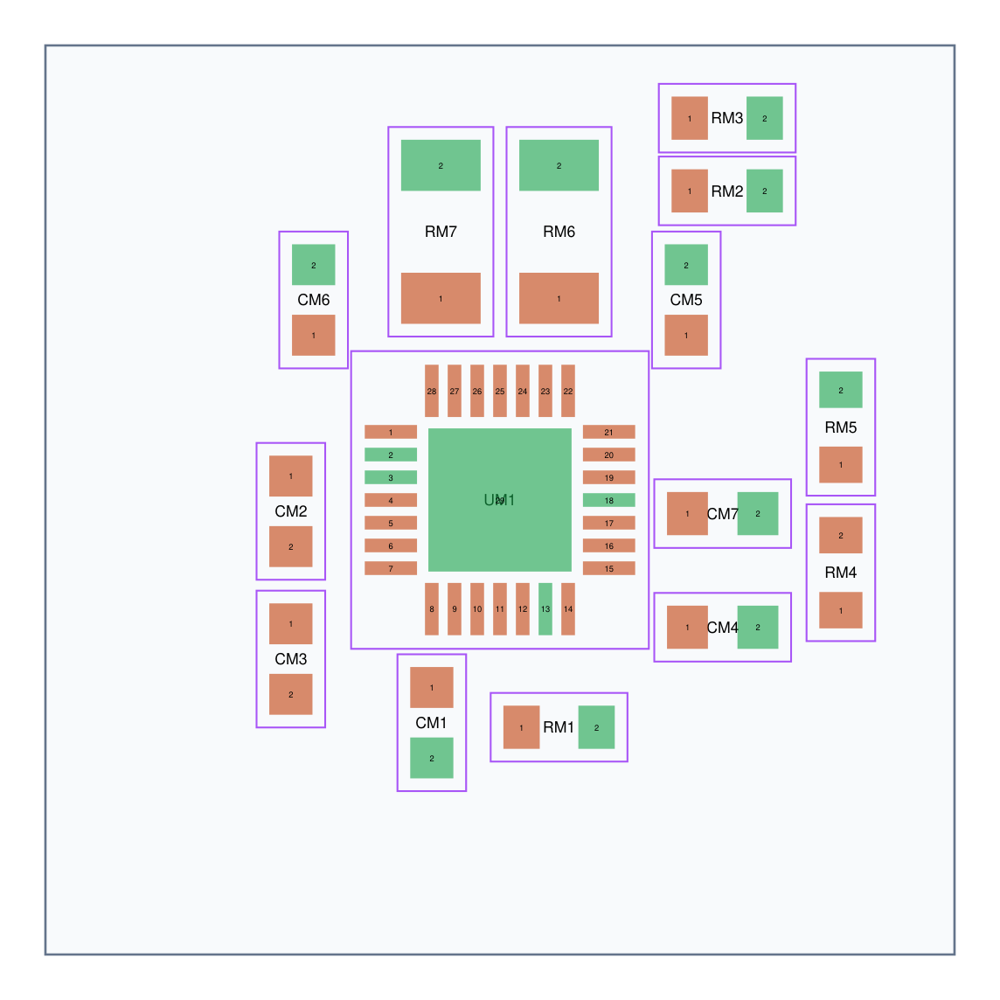
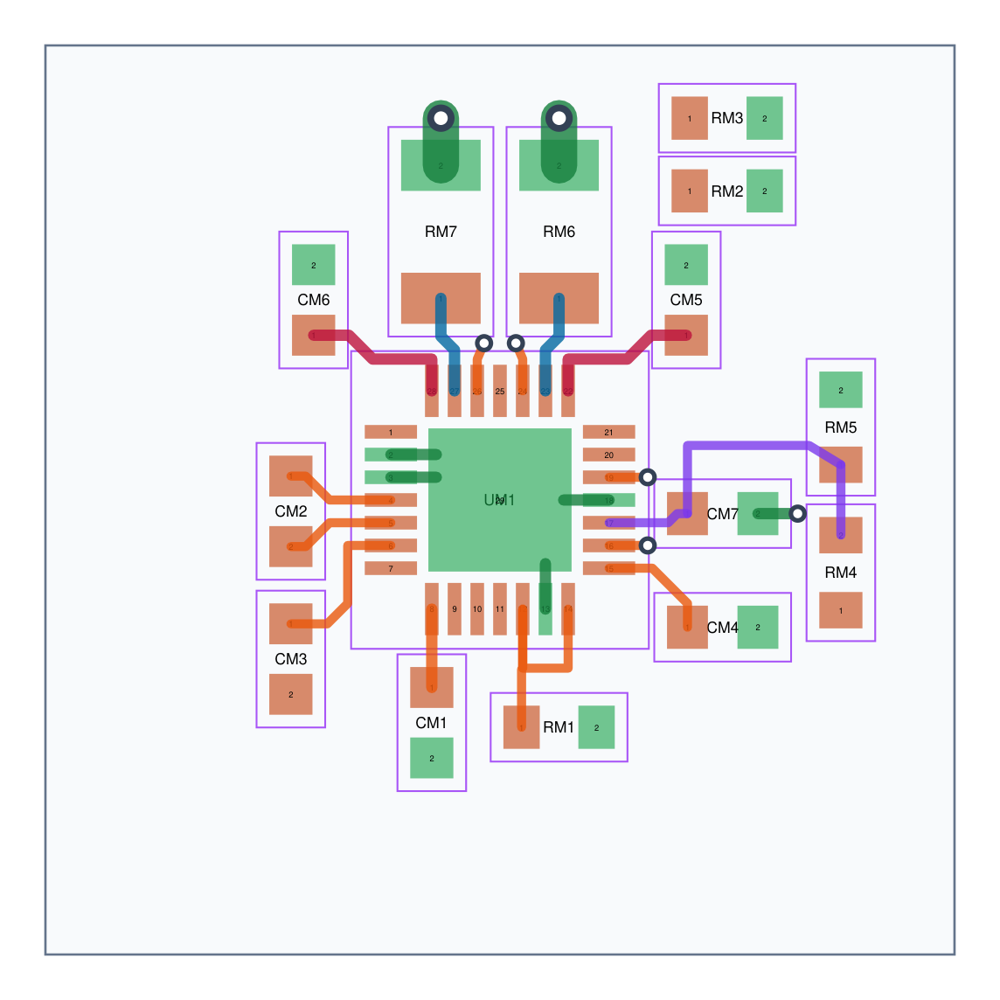

# Compact local placement handoff

**2026-10-24: placement and selected local copper checks PASS.**

- [layout.json](layout.json) is exactly `reference: [x_mm, y_mm, rotation_degrees]`
  for all 19 components in the existing circuit. **UM1 = [0, 0, 0]**.
- Coordinates follow KiCad board convention: **+x right, +y down**, angles are
  passed directly to `FOOTPRINT.SetOrientationDegrees`. In particular, +90°
  places a native resistor's pad 1 below its origin, not above it. Do not use a
  mathematical y-up rotation matrix without converting coordinates.
- RM8, CM8, JM1 and JM2 are **separate movable anchors**. All other 15 parts
  form the core. The anchors are real-footprint checked at their supplied
  positions, but their locations do not prescribe the main-board outline.
- Native THT origins are pin 1: CM8's body centre is offset +2.5 mm in x;
  terminal origins likewise are not their body centres. Preserve footprint
  origins when applying placement, then regenerate supplier centroid offsets.

## Checked geometry

Actual footprints loaded from KiCad **9.0.2** and the existing custom `motor`
library give core courtyard bounds:

```
x: −5.355 .. +8.255 mm
y: −9.155 .. +6.405 mm
size: 13.610 × 15.560 mm
```

The entire core is inside a **20 ×20 mm square centred on UM1**. Courtyard
intersections: **zero**, including the four separate anchors. Different-net
pad clearance violations below 0.20 mm: **zero**; minimum is **0.20 mm**, set
by the A4988's manufacturer land pattern. These checks include unused NC pads.

[layout-checks.json](layout-checks.json) contains the actual rotated pad centres,
pad copper envelopes and courtyard bounds of every footprint. Courtyard tests
use conservative bounding rectangles including courtyard line stroke. Pad
tests use rectangular copper envelopes (conservative for rounded native pads).
No courtyard was deleted or resized to obtain the result.



## Placement intent

- **RM6/RM7**: directly above SENSE1/SENSE2, pad 1 toward the chip. Pad 2 points
  outward into broad ground copper. Their closest sense-pad centres are about
  2.06 mm from the respective IC pin centres.
- **CM5/CM6**: flank the shunts, with VMOT pads facing the VBB pin escapes.
  Distribute VMOT to their pad-1 region; keep their ground returns local.
- **CM2**: 100 nF flying capacitor left of CP1/CP2, rotated so its pad order
  avoids crossed connections. **CM3** sits immediately below it; its pad 2 is
  **VMOT**, not ground.
- **CM1**: below VREG with its supply pad toward the chip. **CM4**: below-right
  of VDD. **CM7**: immediately right of REF, with RM4/RM5 further right in a
  quiet reference region. The divider's shared VREF pads face one another.
- **RM1**: below the RESET/SLEEP pair. **RM2/RM3**: accessible at the top-right
  for STEP/DIR runs on another signal layer. Their positions do not imply that
  their signal and ground connections are already complete.

## Suggested critical escapes and local connections

[critical-routes.json](critical-routes.json) supplies **25 F.Cu polylines and
seven suggested vias**, in the same coordinates, with trace width, net and
actual source/destination pad references. Every stated endpoint was checked
against the KiCad-loaded pad centre. Routes without a pad destination either
end at their named via or inside exposed ground pad 29.

[route-stub-checks.json](route-stub-checks.json) checks the supplied trace
capsules/via annuli against all placed pad envelopes and one another. It reports
**zero violations**, with **0.20 mm minimum** clearance. Small output and signal
escape vias use 0.40/0.20 mm land/drill; the two illustrated shunt ground vias
use 0.60/0.30 mm. Fabrication drill/annular-ring rules still belong to the main
project's actual ruleset.



The sense lines start with 0.25 mm QFN escapes. **The A4988 SENSE pin carries
the bridge return current as well as the measurement; it is not an independent
high-impedance Kelvin input.** Widen free space along the short same-net path
to each shunt. Take the quiet low-side reference from the shunt ground-pad
region back to the exposed-pad star while providing broad power return copper;
do not let unrelated motor, buck or TEC return currents traverse that reference
path. Two-terminal shunts cannot provide a true four-terminal measurement.

Use four layers with **continuous In1.Cu ground**, and In2.Cu/B.Cu for remaining
signal/power escapes. Keep local top/bottom ground spreading and thermal vias
under/around the exposed pad. The core courtyard size is **not** a proven minimum
thermal copper area. The supplied ground stubs/vias are connection examples;
they do not replace the required ground plane, thermal via array, or broad
decoupling/shunt returns. Retain the existing via-in-pad solder-process decision
from the main motor handoff.

Output-A stubs escape between the shunts via short 0.20 mm necks, then change
layer. Widen immediately after escape and assess current capacity/add suitable
vias on that layer; these necks and single vias are not a validated 1 A rating.
MS straps, output-B paths, STEP/DIR pull-down runs, all remaining supply/ground
connections and the CM3-to-VMOT loop remain for integration. In particular,
preserve a short CM3 VMOT return to the same local VBB/ceramic node, rather
than returning it to a distant supply connector.

## Reproduce checks

From repository root:

```sh
docker run --rm --network none --user "$(id -u):$(id -g)" \
  -v "$PWD/electronics/revb/motor:/work" cat-feeder-kicad:local \
  /usr/bin/python3 /work/check_layout.py
docker run --rm --network none --user "$(id -u):$(id -g)" \
  -v "$PWD/electronics/revb/motor:/work" cat-feeder-kicad:local \
  /usr/bin/python3 /work/check_route_stubs.py
```

These regenerate the JSON check records and SVG views. The PNG views are
rasterizations of those SVGs and were visually inspected. The existing circuit,
component selections and footprints were preserved. This handoff is not a fully
routed board, whole-board DRC result, or thermal/assembly qualification.
