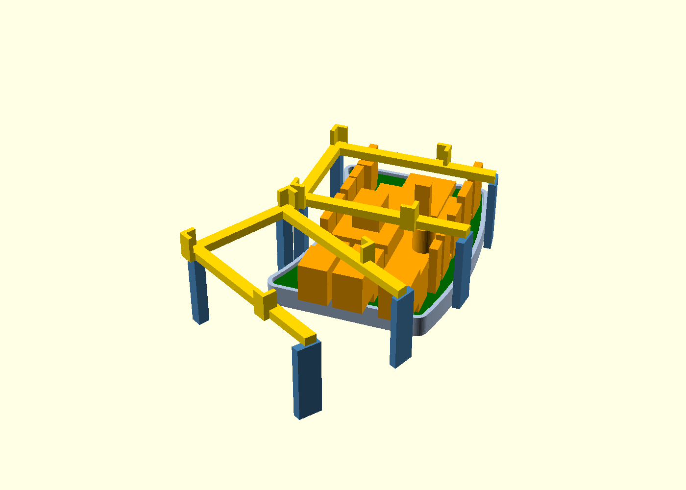
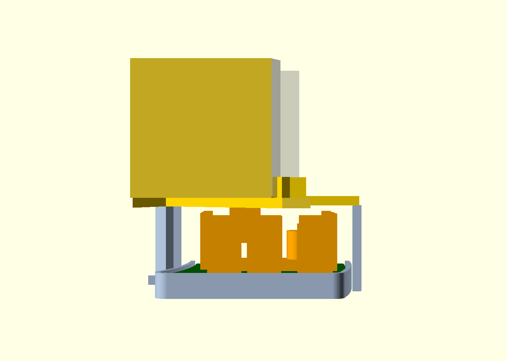

# Crescent PCB: measured geometry and removable supports

2026-10-24. **A feasible prototype geometry, conditional on the component and
harness allowances below.** This is neither physical fit nor thermal/RF
qualification. No PCB/electronics source was changed. See [decisions D17/D24/D25](decisions.md),
[the board handoff](../electronics/pcb/PACKAGING.md), [component sourcing](../electronics/pcb/SOURCING.md),
and the earlier [drop-in layout](drop-in-layout.md).

## Result

- Keep the actual R91–141 crescent at **rotation 0°, PCB bottom Z33**, top Z34.6.
  The imported STL already uses enclosure XY; do **not** apply the STEP offset.
- Add a floor-rooted edge-support pocket and **two identical removable sink
  cradles**, at **0° and −30°**. Remove the old posts/guides at those two sites.
  Ten other complete cartridge support sets, fan seats/skirt, motor posts and
  the other three provisional board pockets are retained.
- Each cradle rests on inner floor pillars and outer floor-rooted, wall-braced
  pillars. All beams crossing the PCB lift out **before** the PCB. Cradle bearing
  top remains Z58; the complete **40 × 40 × 40 mm sink allowances at Z58–98**
  remain in the checks. No 20 mm sink substitution was made.
- **Four small notches in the fixed deck ledge are required** for straight
  top-loading of the cradle ends. They remove about **242 mm³ / 80.7 mm² of
  bearing plan area**, approximately 2.2% of the nominal R142–146 annular ledge.
  The outer wall, fan, floor vents and removable deck size remain unchanged.
- Connect terminal wires **after** seating the board; disconnect them before
  lifting it. Their installed bend allowance fits, but its vertical sweep
  catches the deck ledge. This is staged service, not unrestricted removal of
  a fully wired assembly.

## Actual interference measurements

These are OpenSCAD Manifold boolean volumes, using the delivered board STL and
current CAD at `$fn=120`. They are not bounding-box overlap estimates.
[Full log](../analysis/pcb-fit/checks.echo), [machine-readable report](../analysis/pcb-fit/report.json).

| Intersection | mm³ |
|---|---:|
| PCB laminate / old devkit pocket | 317.859 |
| PCB laminate / original cartridge posts and guides | 69.600 |
| Underside pin allowances / original wire channels | 22.464 |
| Complete populated/wired allowance / old fixed internals | 780.401 |
| Unwired populated board vertical loading / old fixed internals | 1,665.28 |
| Installed connector/harness allowance / −30° original supports | 217.005 |
| Connected terminal-wire loading / adapted shell | 5.270 |
| Cradle loading / original unnotched ledge | 170.357 |
| Same populated PCB raised to bottom Z65 / full 40 mm sinks | 13,974.1 |
| PCB rotated +15° / the chosen cradle geometry | 70.399 |

The −30° posts do not obstruct the **unwired** PCB sweep; they obstruct the
**installed terminal harness**. This is why two sites are adapted. The +30°
posts need no change. The +30° sink itself must be lifted for board access.
The 0° choice also keeps the tall driver heatsink between the cradle's beams;
this is a checked placement, not a proof that no other layout is possible.

Putting the board above the old guides is not a shortcut: their top is Z64,
and a Z65 board strongly intersects the actual Z58–98 sink volumes. A
wall-following outline alone does not resolve the existing mechanical clashes.

## Installed datums and explicitly provisional parts

| Feature | Envelope / nominal clearance |
|---|---|
| Floor top / PCB seat | Z28 / Z33; 5 mm below laminate |
| PCB | Actual supplied outline, nominal 1.6 mm thickness |
| Underside solder/pin allowance | Up to 3.2 mm **below** laminate; 1.8 mm above floor |
| Edge seat | 0.8 mm inward bearing lip; 0.5 mm side fit; 1.5 mm guide wall |
| Guide top | Z35.6: 1 mm above the PCB top; no overhanging fixed retention |
| Fan and motor bridge | Fan Z30–55; original motor bridge begins Z56, retaining its 1 mm gap |
| Cradle beam / sink bearing | Z55–58 / Z58; L guides end at Z64 |
| ESP32 module | Actual footprint origin; 18 × 25.5 × 3.3 mm height allowance |
| C10 | Actual D8 × 11.5 mm Panasonic body; centre is 2.5 mm from pin 1 |
| Phoenix terminals | Native footprint 10.2 × 9.8 mm; **15 mm provisional height allowance** |
| Vertical headers | 3 mm wide allowance, actual origin/count/rotation; 8.5 mm bare / **18 mm with mating and bend allowance** |
| A4988 sockets | Actual 15.24 mm row spacing, 8-pin pitch; sourced 8.5 mm socket height |
| Carrier body/components | **20.32 × 22.86 mm provisional body**, 1.6 mm laminate + 2 mm devices above the sockets |
| Driver heatsink | **Unselected 10 × 10 × 10 mm allowance**, centred on carrier; combined stack 22.1 mm above main PCB |
| Terminal wire exit | **12 mm provisional horizontal exit/bend space**, Z38.6–52.6 |

The 3.2 mm underside allowance is conservative relative to the quoted socket
tail length through a 1.6 mm PCB; terminal leads, solder buildup and untrimmed
capacitor leads still need confirmation. The connector boxes are packaging
reservations, not complete manufacturer STEP models. Small SMT parts are
conservatively covered by a 2 mm-high occupied-region box. Positions and native
rotations come from `electronics/pcb/design-bom.csv`, not visual centring.

### Tight interfaces to verify before selecting hardware

- Driver allowance top is **Z56.7**, leaving **1.3 mm** to the sink bottom.
  With a 1 mm desired gap the total main-PCB-to-stack height limit is **22.4 mm**.
  A taller carrier/heatsink needs a fresh fit study or a changed component/PCB
  arrangement; it cannot be accepted on the present results.
- The driver heatsink box occupies **X102.62–112.62, Y−14.89–−4.89,
  Z46.7–56.7 mm**. The nearest central beam begins at Y−16, leaving **1.11 mm**.
  A 12 mm-wide heatsink at the same centre would leave only 0.11 mm. The
  10 mm box is a constrained fit allowance, not a recommendation for thermal duty.
- Mated header/wire reservations end at Z52.6, **2.4 mm** below cradle beams.
  Actual connector latches, cable gauges, bend radii and strain relief are open.
- Cradle ends have **0.5 mm nominal radial bore clearance** and notch clearance.
  The outer fixed pillars join the wall by 0.2 mm rather than leaving a narrow
  unprintable gap; they still have full floor roots. The small locating pegs,
  socket fit, print shrinkage and warm deflection require coupon trials.
- The antenna end is beside the +30° thermal site. The modeled metal sink bottom
  is at least **20.1 mm vertically above** the ESP32 body top. This does not
  certify antenna clearance or RF performance: nearby board headers and harness
  routing also matter, and the nominal antenna-to-J8-header planar gap is only
  about **8.6 mm**. Keep RF review independent of mechanical collision success.
- Each new cradle shadows **384 mm² (24%)** of its 1,600 mm² sink footprint in
  plan. This is measured geometry, **not** an airflow reduction percentage.
  Its effect on the bottom-up cooling path must be checked with the real fins.
- These are gravity-seated, laterally bounded parts. They do not implement
  anti-lift shipping retention, thermal compression, TEC height adjustment,
  moisture isolation or a qualified hot-side cartridge.

## Service order

1. Remove tray/hub/drive and the relevant deck pieces. Lift the −30°, 0° and
   +30° cartridges to expose the PCB area. Lift both removable cradles.
2. Lower the unwired populated PCB onto its edge seat; no fixed beam crosses
   this path. Install the fan and motor bridge in their existing staged order.
3. Mate headers and connect terminal leads while the top is exposed. Straight
   Ø6 mm screwdriver approaches to all six terminal positions clear the fixed
   enclosure and motor bridge in the checked model. Hand/grip space is untested.
4. Lower the two cradles through their ledge notches onto their floor pillars.
   Then lower the full-height sink/TEC cartridges and reinstall deck/tray parts.
5. Reverse for deep service; disconnect terminal wiring before raising the
   PCB. Ordinary food-tray cleaning does not require entering this equipment bay.

## Primary integration recipe

**Integration completed:** `cad/feeder.scad` now uses the adapted supports,
four ledge notches, actual PCB envelope and separate cradles. The obsolete
devkit envelope is hidden; the three other provisional module pockets remain.
Main exports have been regenerated and inspected: 44 main checks and all 21
study checks pass; thirteen printable meshes and eleven unsliced Bambu projects
pass their checks. See [validation](validation.md) for current evidence. The
recipe below records the applied changes.

Only the new library and this analysis were changed by the mechanical subagent.
The primary owns integration into `parameters.scad`, `internals.scad`,
`feeder.scad`, exports and KB index. The library is
[`cad/pcb_mount.scad`](../cad/pcb_mount.scad).

1. Add `use <pcb_mount.scad>` to `feeder.scad`.
2. At the **shell's call site**, replace `internals();` with
   `pcb_adapted_internals();`. This module subtracts
   `pcb_existing_features_keepout_cut()` from the old internals, then unions
   `pcb_supports()` and `pcb_cradle_pedestals()`.
   **Keep the old `internals()` provider available; making it call
   `pcb_adapted_internals()` would recurse.** The wire-channel cutter is
   restricted outside R129 so it preserves the +30° support roots.
3. Inside the shell's existing wall/floor/ledge `difference()`, add
   `pcb_shell_loading_notches();` beside the vent/floor cutters. Do not apply
   the legacy-feature cutter to the complete shell/floor. No other shell
   dimensions or removable-deck geometry need changing for this placement.
4. In assembly views add `pcb_populated_envelope()` and
   `pcb_cartridge_bridges()`. The bridges are **separate removable parts**;
   never union them into the fixed shell. Replace the obsolete ESP32-devkit
   envelope. Retained USB-PD/buck/driver pockets are only legacy allowances;
   this study does not qualify external rail modules or fit a DPS5005 there.
5. Export two copies of `pcb_cartridge_bridge_print()` and optionally
   `pcb_mount_coupon()`; both are bed-oriented. The coupon includes the PCB
   edge seat and central cradle pillars on a small floor, not the complete shell.
6. Update the primary assembly/load checks for the actual PCB and staged
   service. Use `pcb_loading_path()` with wires disconnected,
   `pcb_cartridge_loading_path()` for the cradle sweep and
   `pcb_terminal_access_paths()` for the limited driver-access test. The study's
   checks show the required comparisons against the complete integrated shell.
7. Link this page from the KB index and regenerate main exports/checks after
   integration. Do not treat the old four-board loading checks as verification
   of this controller. No supplier project is justified by this mechanical
   prototype alone; the independent electrical review remains separate.

`analysis/pcb-fit/shell-fixture.scad` now delegates adapted checks to the actual
main `shell()` and reconstructs a legacy shell solely for before/after
diagnostics. It imports existing helpers and parameters. This avoids a
misleading surrogate floor or post-hoc subtraction of support solids from it.

## Verification and printable coupons

The final study has **21 passing empty-intersection assertions**, maximum
residual below **1.2 × 10⁻¹⁰ mm³**, against the existing 0.001 mm³ threshold.
Checks include complete-shell PCB/cradle sweeps, installed components, full
sink envelopes, deck, fan loading, motor bridge, preservation of the fan/motor
supports and all ten unrelated cartridge support sets, and terminal access.
The cradle sweep preserves its locating-socket voids and adds a conservative
0.01 mm XY growth; it is not a projected solid that falsely fills the sockets.

| Export | Actual STL size (mm) | Result |
|---|---:|---|
| [Cradle](../analysis/pcb-fit/cradle.stl), print two | 61.599 × 44 × 9 | One connected closed outward surface; Z=0; within 170 mm |
| [PCB fit coupon](../analysis/pcb-fit/coupon.stl) | 66 × 88 × 32 | One connected closed outward surface; Z=0; within 170 mm |
| [Integrated shell fixture](../analysis/pcb-fit/adapted-shell.stl) | 316 × 322.5 × 123.5 | One connected closed outward surface; full shell is not a small-bed print |

The existing `scripts/check_mesh.py` checker is imported directly. It checks
the actual binary STLs, manifold edges, connectedness, positive signed volume
and print bounds; only exactly collapsed float32 triangles may be removed.
No tolerant welding or hole patching is used. The initial broad wire cutter
trimmed an unrelated support root and was narrowed; an exact-copy cutter
created a non-manifold exported edge and was replaced by bounded coarse cuts.
Those failed variants are superseded by the checked library.

Reviewed the final local oblique, section, top and ledge views. The local view
shows the two removable U cradles, their separate floor load paths and driver
allowance between beams; the section retains the full 40 mm sink height.
[Ledge view](../analysis/pcb-fit/ledge.png) shows the four localized passages.
Source hashes, diagnostic volumes and actual mesh results are in the report.

Reproduce with `python3 analysis/pcb-fit/build.py all` using the existing
`rowing-openscad` image; no host package installation or upstream edits are
needed. This regenerates the fixture, checks and STLs. The views use the same
`study.scad` with `part="local"`, `"section"`, `"view"` or `"ledge"`.
