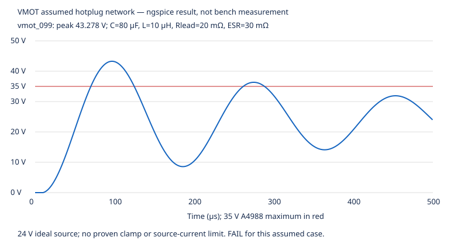

# PCB power simulation — executed operating-envelope study

**2026-10-24: suite execution PASS; tested envelope FAIL; circuit qualification
CONDITIONAL. No physical tests performed.** The frozen, reviewed 54-part PCB and
all 85 manifest entries were checked without modification. This study does not
change the supplier-preparation clearance in [PCB review](pcb-review.md).

Related: [decisions](decisions.md), [PCB design](pcb-design.md),
[model contract and sources](../electronics/sim/power/README.md),
[machine-readable results](../electronics/sim/power/results/summary.json),
[source/tool provenance](../electronics/sim/power/results/provenance.json).

## What actually ran

- **308 distinct ngspice transient circuits:** 162 VMOT RLC cases, 144 behavioral
  regulator load steps, one lossless LC oracle, one capacitor-charge oracle.
  Two VMOT cases were repeated to preserve representative full waveforms.
- **36 analytical steady-state thermal corners** and nine derived current limits.
- **12 integrity test methods PASS:** reviewed-source/mutation and analytical-oracle
  checks, invalid-SPICE rejection, early and late failure publication, atomic
  replacement, KeyboardInterrupt/SIGKILL handling, unwritable output, and retained
  waveform validation. See the publication-fix section below for executed status.
- Actual toolchain: **Python 3.12.14, ngspice 39**, image
  `sha256:48cf511518c3085a51e342c6076d2e8c81d415f469a1da941c59c97baafc9b91`.
  Reproduction uses the project Dockerfile/image, no host installation or network.
- `run.py --output DIR` returns nonzero for schema, solver or numerical-oracle
  failure. Exit zero and `suite_execution: PASS` **do not** mark engineering
  failures as passed. `tested_envelope: FAIL` and individual FAIL rows remain.

## Publication-integrity correction following independent review

The [independent review P1](pcb-simulation-review.md#p1--blocking-report-integrity-defect-late-error-writes-suite-pass)
identified a genuine defect: a late artifact-write failure could leave PASS in
the error report, and interruption could leave the previous attempt's PASS.
The power runner now assigns a unique run ID and **atomically publishes RUNNING
before source validation**, records stages, and publishes COMPLETE/PASS only
after required artifacts finish. Caught exceptions explicitly publish FAIL/FAILED;
KeyboardInterrupt publishes FAIL/ABORTED (exit 130). Other caught failures return 1.

SIGKILL cannot publish a failure handler: the new attempt stays **RUNNING**, which
means incomplete/interrupted and must not be consumed as a completed result.
Provenance carries the same run ID. Reused artifacts can be mixed until COMPLETE;
use one writer per output directory. Atomic replacement prevents partial JSON,
but an unwritable output medium cannot guarantee a new failure record; callers
must honor nonzero process exit as well. UUIDs/timestamps are intentionally not
byte-identical between runs.

Regressions perform three full actual-solver runs: injected model-hash publication
failure, final-summary publication failure, and a child process killed with
SIGKILL immediately before final summary publication, each replacing a seeded
previous PASS record. Retained VMOT reruns now share all normal waveform/log
validation and must reproduce first-solve voltage/current peaks before compression.
Six injected zero-exit invalid/stale-output cases and an actual-solver peak-mismatch
test exercise this path. Execution status and unchanged operating-corner failures
are reported separately below and in the regenerated results.

**Executed after the fix, network disabled in the same image:** normal study
COMPLETE/PASS, **308 distinct circuits / 310 solver invocations**, 36 thermal
corners and nine derived current limits. **All 12 test methods PASS** (including
the three full-study failure/kill regressions); all **85 frozen PCB hashes match**.
Thermal **18/36**, VMOT **17/162**, and behavioral-LDO **97/144** operating criteria
still fail as before. Published run ID: `38a73de682c943d79b175216548a3fb1`, completed
2026-10-24 16:26:35 UTC. No electrical model or physical qualification claim was
changed by the publication correction.

## AP2112 heating: an operating-current limit, not a 600 mA thermal rating

Actual U2 is **AP2112K-3.3TRG1 / C51118, SOT25**. The reference calculation uses
published θJA **184°C/W**, maximum published quiescent-current figure **80 µA**,
nominal output 3.3 V, and a **125°C junction design target**:

`Pd = (VIN − 3.3) × Iload + VIN × 80 µA`

`Tj = ambient + 184 × Pd`

VIN means the voltage at U2, not at the far end of a lossy supply cable. The
load budget is shared by ESP32, A4988 logic and every external 3.3 V consumer.

### Calculated junction temperature at 50°C ambient

| Total load | VIN 4.75 V | VIN 5.00 V | VIN 5.25 V |
|---|---:|---:|---:|
| 200 mA | 103.43°C | 112.63°C | 121.84°C |
| 240 mA | 114.10°C | **125.15°C FAIL** | **136.19°C FAIL** |
| 300 mA | **130.11°C FAIL** | **143.91°C FAIL** | **157.72°C FAIL** |
| 500 mA | **183.47°C FAIL** | **206.47°C FAIL** | **229.48°C FAIL** |

Temperatures beyond ratings are **algebraic evidence of an unsupported load**,
not stable operating predictions: shutdown/foldback would invalidate the simple
model. The actual board θJA and installed ambient are unknown. Even 200 mA at
5.25 V/50°C has only **3.16°C nominal margin**, before thermal/layout uncertainty.
Across 25/40/50°C ambient and 4.75/5/5.25 V, **18 of 36 corners fail 125°C**.

### Continuous-load ceilings at 50°C for a 125°C target

| U2 VIN | Nominal 3.3 V output | Additional −1.5% output sensitivity |
|---|---:|---:|
| 4.75 V | 280.85 mA | 271.58 mA |
| 5.00 V | 239.53 mA | 232.76 mA |
| 5.25 V | **208.81 mA** | **203.65 mA** |

These are conditional **total** load ceilings with no extra engineering margin,
not recommended current settings. −1.5% is a sensitivity, not a claim that the
manufacturer's 25°C accuracy establishes all-temperature behavior. Full corners:
[thermal.csv](../electronics/sim/power/results/thermal.csv) and
[thermal-current-limits.csv](../electronics/sim/power/results/thermal-current-limits.csv).

## Regulator load steps: behavioral sensitivity, not a validated AP2112 model

No immediately linked AP2112 manufacturer SPICE model was obtained from the
manufacturer product/model pages. The runner explicitly uses an assumed
current-pass controller with first-order lag, finite gain, headroom and hard
current ceiling. Input/output pass current is conserved and initial branch KCL
is checked. Actual netlist output storage is **C2+C4 plus C3/C6/C7/C9 = 20.4 µF
nominal**, with 10 µF C1 at VIN; capacitance, ESR and control assumptions are
fully disclosed in the [model contract](../electronics/sim/power/README.md).

- Grid: VIN 4.75/5/5.25 V; source resistance 0.1/2 Ω; effective C factor 0.3/1;
  assumed lag 2/20/100 µs; current ceiling 0.6/0.8 A; load 100→500 or 100→700 mA.
  700 mA is explicitly an overload beyond the 600 mA guaranteed output rating.
- Example `ldo_060`: 5 V, 0.1 Ω, nominal C, 2 µs lag, 600 mA limit,
  100→500 mA load: simulated **3.24242–3.29758 V** at the output and
  **4.94711 V minimum** input pin voltage. CONDITIONAL under this assumed model.
- **97/144 cases fail the assumed 3.0–3.6 V rail criterion**, comprising 36/72
  500 mA cases and 61/72 700 mA overload cases. Long-lag cases can collapse or
  overshoot strongly; the overall assumed-model minimum is **0.20758 V**, and
  maximum across the grid **5.18999 V**. These are **not predictions that the
  actual AP2112 exhibits those excursions** and do not validate its loop response.
  They identify dependence on response, effective storage and source capability.

The broad slow-response cases are a stress sensitivity, not an exhaustive or
guaranteed worst-case regulator bound. No burst-duty thermal allowance is
inferred. Details: [ldo-sensitivity.csv](../electronics/sim/power/results/ldo-sensitivity.csv).

## VMOT input LC: C10 does not prove a clamp

Actual C10 is **Panasonic EEUFR1H101B / C713402, 100 µF/50 V, ±20%**. The model
uses 80/100/120 µF, assumed lead L 0.5/2/10 µH, source/wire R 20/100/500 mΩ,
and assumed ESR 30/61/200 mΩ. The catalogue's **61 mΩ at 100 kHz is impedance,
not a measured broadband ESR**. A 1 ns source connection to a discharged
capacitor deliberately excites the passive network. No TVS or source-current
limit is invented; the carrier and motor are not modeled as switching devices.

| Simulated case | Peak VMOT | A4988 35 V criterion |
|---|---:|---|
| 24 V; 80 µF; 10 µH; 20 mΩ wire; 30 mΩ ESR | **43.27801 V** | **FAIL by 8.27801 V** |
| 20 V; same passive assumptions | **36.06503 V** | **FAIL by 1.06503 V** |
| 24 V; 100 µF; 2 µH; 100 mΩ wire; 61 mΩ ESR | 27.08140 V | CONDITIONAL |

**17/162 assumed cases exceed 35 V.** Simulated ideal-source inrush is 61.03 A
for the 43.28 V example: real supply impedance/current limiting/contact dynamics
must be measured before interpreting that current physically. C10's 50 V rating
does not increase A4988's 35 V limit. Source nominal 20 V alone does not eliminate
the issue under the assumed high-L/low-R case.



Every complete RLC voltage trace is independently checked against the closed-form
series-RLC solution, including terminal ESR voltage. Largest disagreement across
all cases: **2.367 mV**, within the enforced 0.2%-of-VIN tolerance. Lossless check:
**47.999995 V** versus analytical **48 V**, with peak time **109.3676 µs** versus
**109.3464 µs**. Capacitor-charge check: **3.103931275 V** versus
**3.103931373 V**. These validate numerical execution of the assumed equations;
they do not validate assumed parasitics. Full [VMOT CSV](../electronics/sim/power/results/vmot.csv).

## Bench qualification priorities

1. **Measure actual total 3.3 V load and rail voltage** during boot, sustained
   radio traffic, all sensors and motor logic active. Scope at U2 and ESP32 with
   the intended supply/harness, including load removal. Characterize effective
   capacitance and response rather than treating the behavioral sweep as a fit.
2. **Thermal soak at the intended bay ambient**, especially 50°C and high VIN,
   with qualified temperature measurement/thermal correlation. Establish actual
   board thermal resistance and permissible total continuous load. If sustained
   300–500 mA is required in a warm enclosure, the present reference budget fails;
   resolve regulator architecture before that use-case build.
3. **Measure VMOT at the installed carrier** using the actual supply, maximum
   harness length and C10, across source connection and motor acceleration,
   braking/regeneration and shutdown. Establish peak/ripple margin below 35 V
   and source behavior. Qualify damping or a suitable clamp if needed; no proven
   clamp is represented in this PCB/model. Carrier ceramic and fast local layout
   resonances, contact bounce and regeneration remain unbounded here.
4. Qualify connector/capacitor ripple/inrush and motor phase heating separately;
   simulator peak current is not a component surge rating. No physical trial or
   unattended-operation qualification has been completed by this study.

## Exact reproduction

From repository root, with the shared image available:

```sh
docker run --rm --network none --user "$(id -u):$(id -g)" \
  -e SIM_IMAGE_ID="$(docker image inspect cat-feeder-spice:local --format '{{.Id}}')" \
  -v "$PWD:/work:ro" -v "$PWD/electronics/sim/power/results:/results" \
  cat-feeder-spice:local python electronics/sim/power/run.py --output /results

docker run --rm --network none --user "$(id -u):$(id -g)" \
  -v "$PWD:/work:ro" -v "$PWD/electronics/sim/power/results:/results" \
  cat-feeder-spice:local python electronics/sim/power/test_run.py --output /results
```

All generated model netlists, logs, source hashes, CSV/JSON summaries and selected
compressed full waveforms are durable under `electronics/sim/power/results/`.
The 12-method test log includes the deliberately exercised failure paths; the numerical
suite's status is separately recorded. This page preserves the distinction between
**simulation**, **analytical thermal estimate** and **unperformed physical test**.
